<p align="center">
  <a href="https://saket-vanga.github.io/astronova/">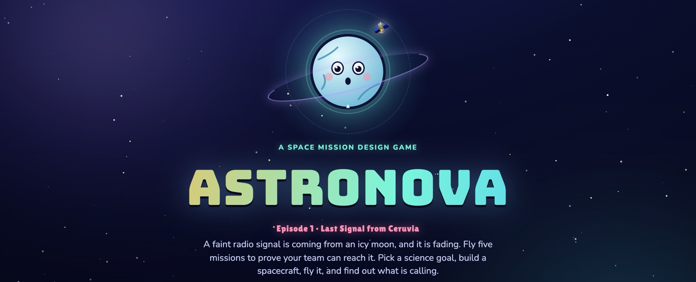</a>
</p>

<h3 align="center">Design a spacecraft. Fly the mission. Answer the signal.</h3>

<p align="center">
  A space mission design game by <b>Team Hubble Huddle</b> for the 2026 NASA Space Apps Challenge, "Space Mission Design Game".
</p>

<p align="center">
  <a href="https://saket-vanga.github.io/astronova/"></a>
</p>

<p align="center">
  
  
  
  
  
  
</p>

<p align="center">
  <a href="#-screenshots">Screenshots</a> ·
  <a href="#quick-start">Quick start</a> ·
  <a href="#how-a-mission-works">How to play</a> ·
  <a href="#playing-together-co-op">Co-op</a> ·
  <a href="#the-engineering-model">The science</a> ·
  <a href="#for-developers">Developers</a>
</p>

---

> **A faint radio signal is coming from Ceruvia, an icy moon 1.4 billion km away, and it is fading.**
> Nobody will fund a trip that far until your team proves it can fly. Over five missions you pick a science goal, build a spacecraft from parts with real trade-offs, pass a launch review, fly each part of the trip yourself, do the science, and read a report on what worked.

There is no single right answer. A heavy, power-hungry design can work if you pay for a bigger rocket. A cheap one can work if you take a slower route. The game shows you the consequences and lets you try again. It runs in any modern browser on a phone, tablet or computer, with **no install and no account**.

## ✨ At a glance

<table>
  <tr>
    <td width="33%" valign="top"><h3>🔬 Science first</h3>Every mission starts with a question. Pick a prime goal, see who uses the data, and build only what the goal needs.</td>
    <td width="33%" valign="top"><h3>🔧 Real trade-offs</h3>32 parts, 4 rockets and 3 spacecraft sizes. Mass, fuel, power, data, budget and time all pull against each other.</td>
    <td width="33%" valign="top"><h3>🕹️ Fly it yourself</h3>Six arcade minigames: launch, a debris field, orbit insertion, landing, a touch-and-go sample grab and reentry.</td>
  </tr>
  <tr>
    <td valign="top"><h3>🧭 Like a real team</h3>A JPL Concept Maturity phase bar, a launch review split into NASA's four segments, a trade study, a mission timeline and trajectory diagrams.</td>
    <td valign="top"><h3>🌱 Made for beginners</h3>Ollie the coach, "Build it for me", plain-language help and autopilots. Beginner is very hard to fail, and Flight Director is a real challenge.</td>
    <td valign="top"><h3>👥 Play together</h3>Online co-op for 2–4 players with four crew roles, a GO / NO GO launch vote and live watching while a crewmate flies.</td>
  </tr>
</table>

## 📸 Screenshots

<p align="center">
  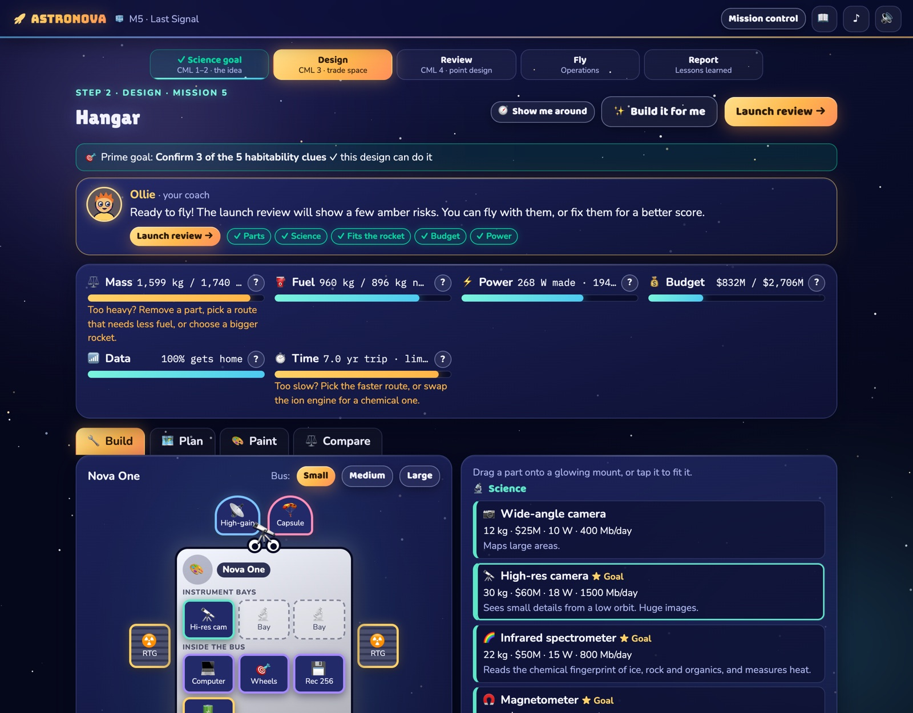
  <br><sub><b>The hangar.</b> Fit parts onto the spacecraft, watch six live meters, and let Ollie the coach show you the next step.</sub>
</p>

<table>
  <tr>
    <td width="50%">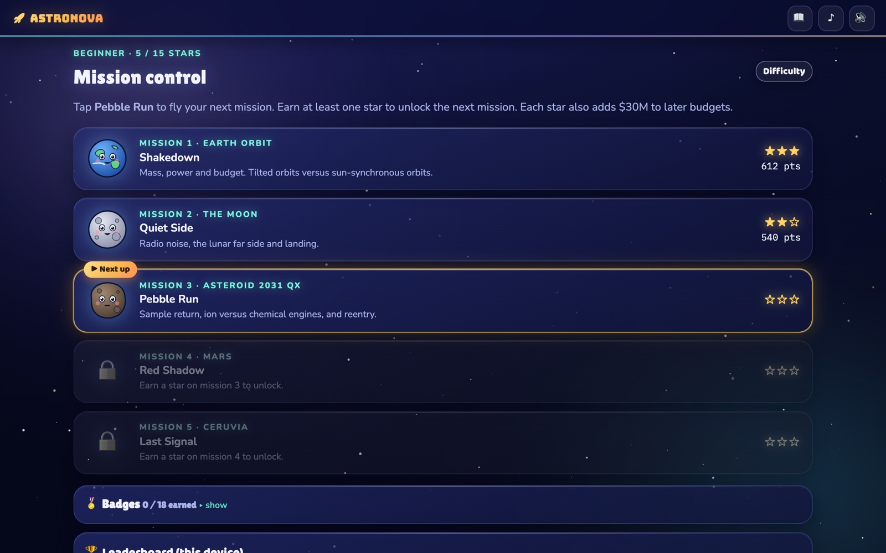<br><sub><b>Mission control.</b> Five missions from Earth orbit to Ceruvia. The next one always glows.</sub></td>
    <td width="50%">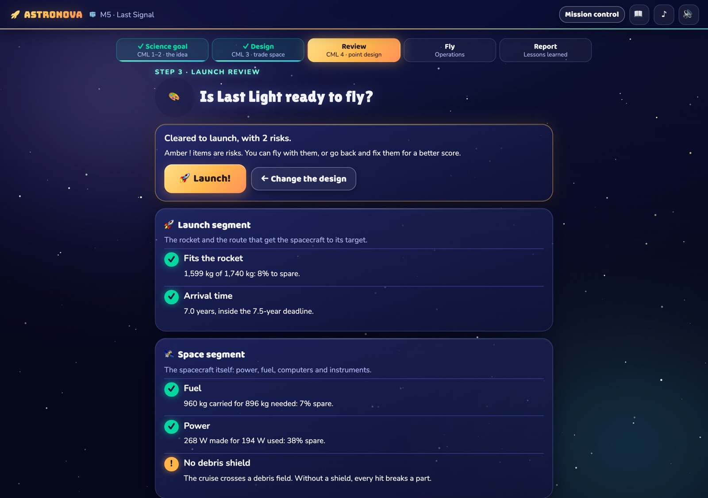<br><sub><b>Launch review.</b> Every check, grouped into NASA's launch, space, ground and user segments.</sub></td>
  </tr>
  <tr>
    <td>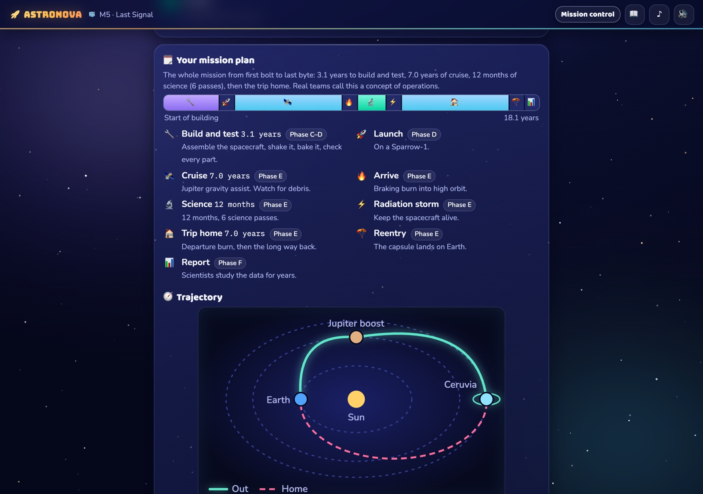<br><sub><b>Mission plan.</b> A concept-of-operations timeline and a trajectory diagram for your chosen route.</sub></td>
    <td>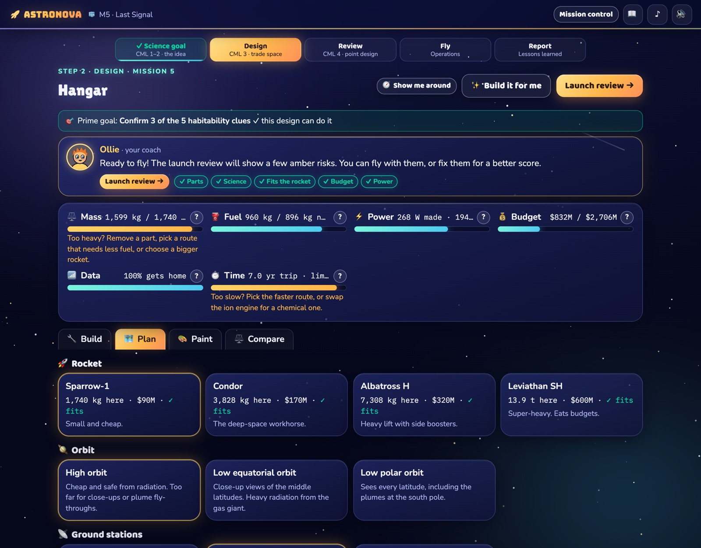<br><sub><b>Plan tab.</b> Pick a rocket, an orbit and ground stations. Each choice changes the meters.</sub></td>
  </tr>
</table>

### 🕹️ Fly every phase

<table>
  <tr>
    <td width="50%">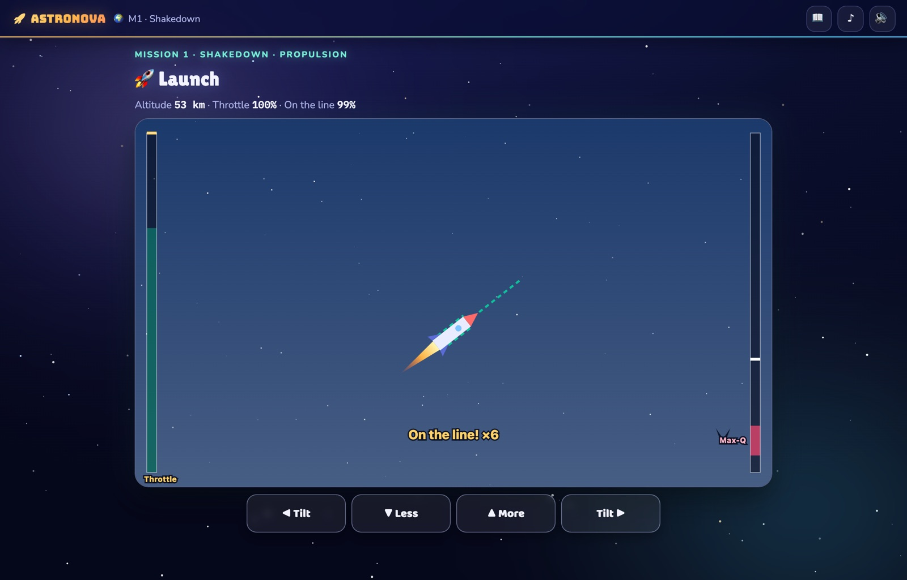<br><sub><b>Launch.</b> Follow the gravity turn and ease off at Max-Q.</sub></td>
    <td width="50%">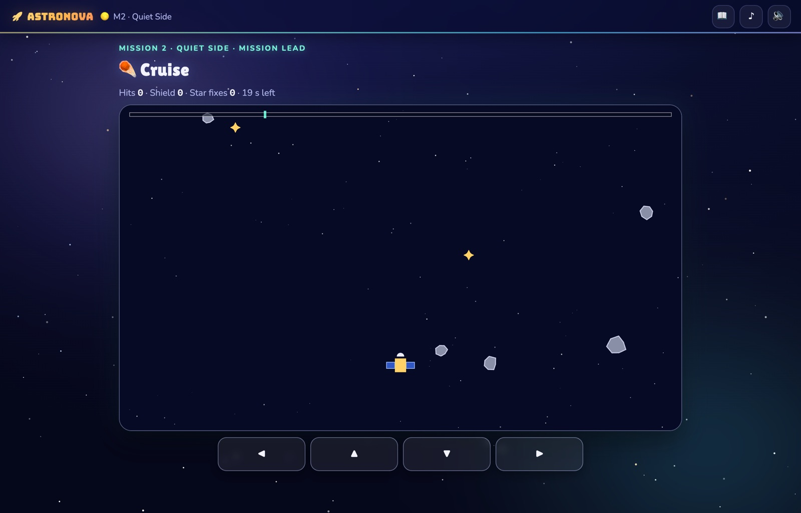<br><sub><b>Cruise.</b> Dodge debris and grab star fixes.</sub></td>
  </tr>
  <tr>
    <td>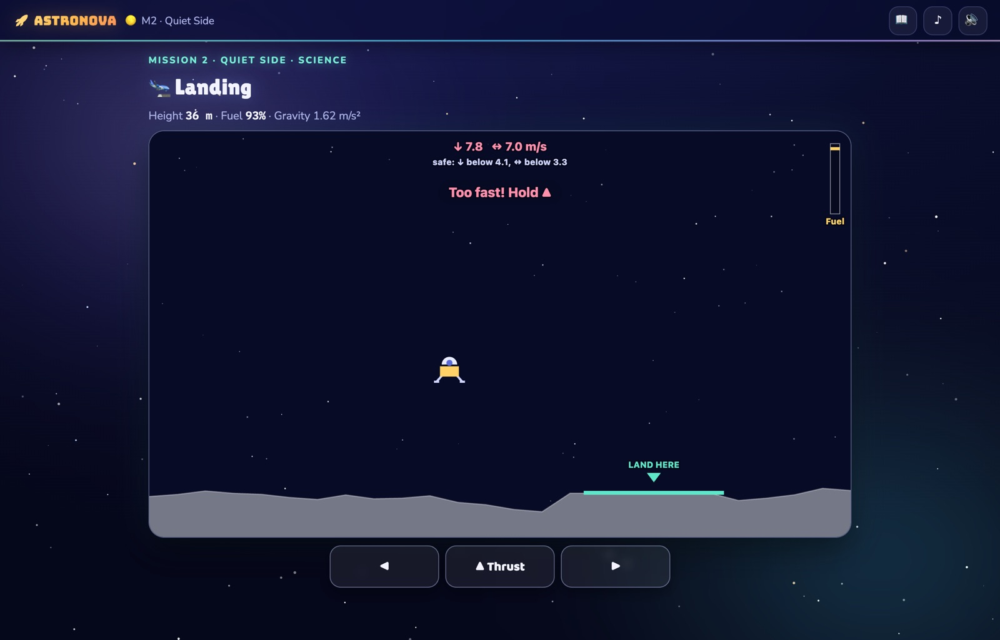<br><sub><b>Landing.</b> Touch down gently on the flashing pad.</sub></td>
    <td>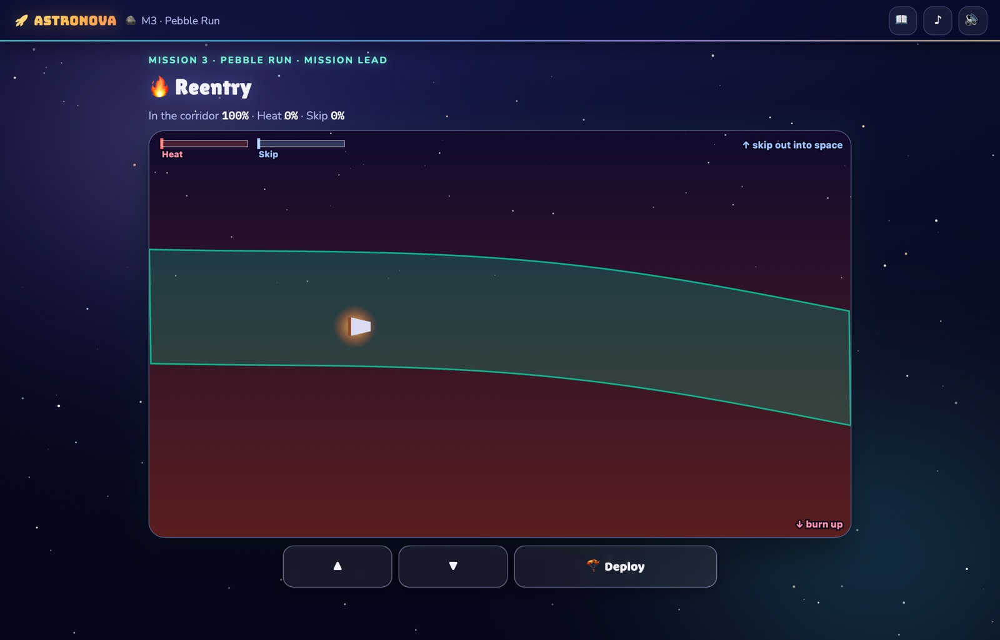<br><sub><b>Reentry.</b> Hold the corridor, then pop the parachute.</sub></td>
  </tr>
</table>

### 🔭 Do the science

<table>
  <tr>
    <td width="50%">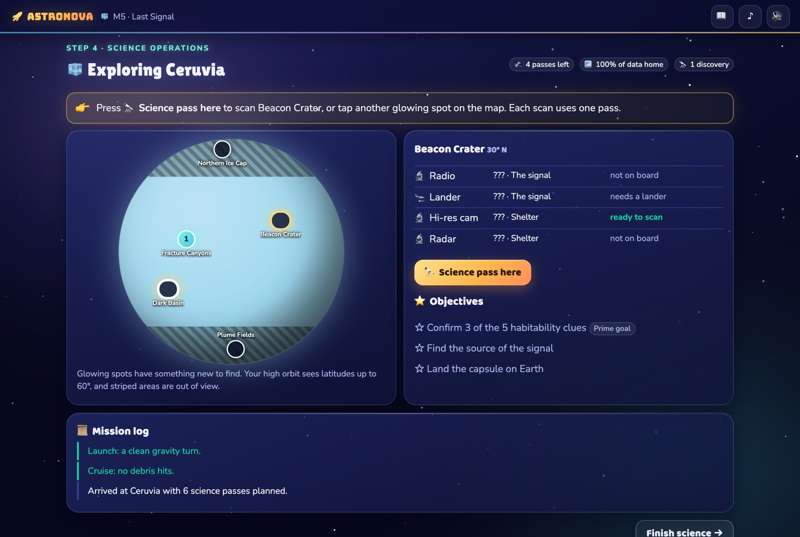<br><sub><b>Science operations.</b> Choose where to point your instruments. Glowing spots still hide discoveries.</sub></td>
    <td width="50%">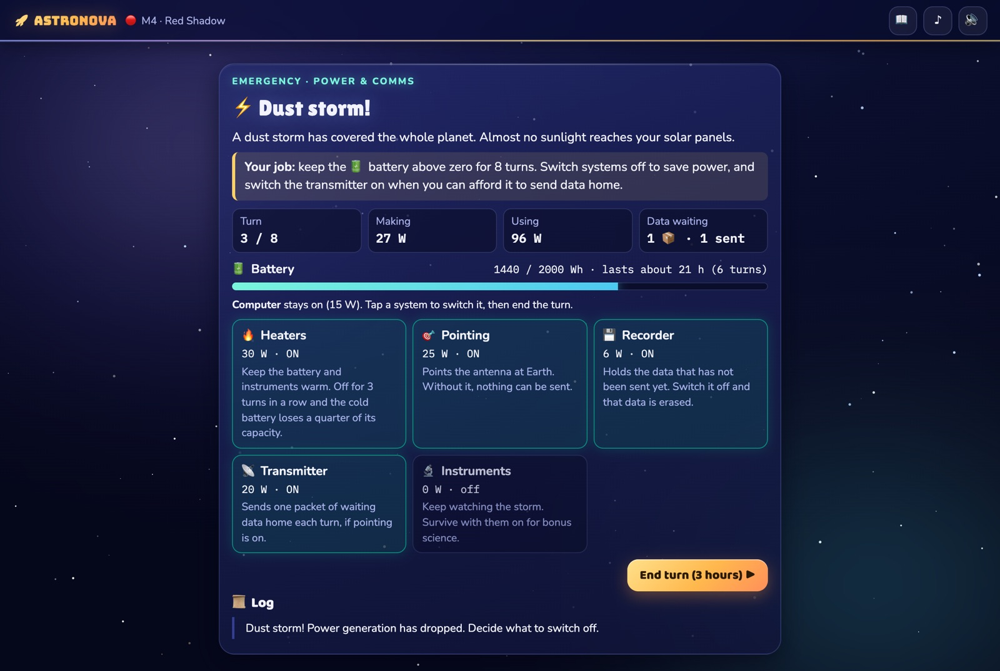<br><sub><b>Power emergency.</b> A dust storm cuts the sunlight. Decide what to switch off.</sub></td>
  </tr>
  <tr>
    <td>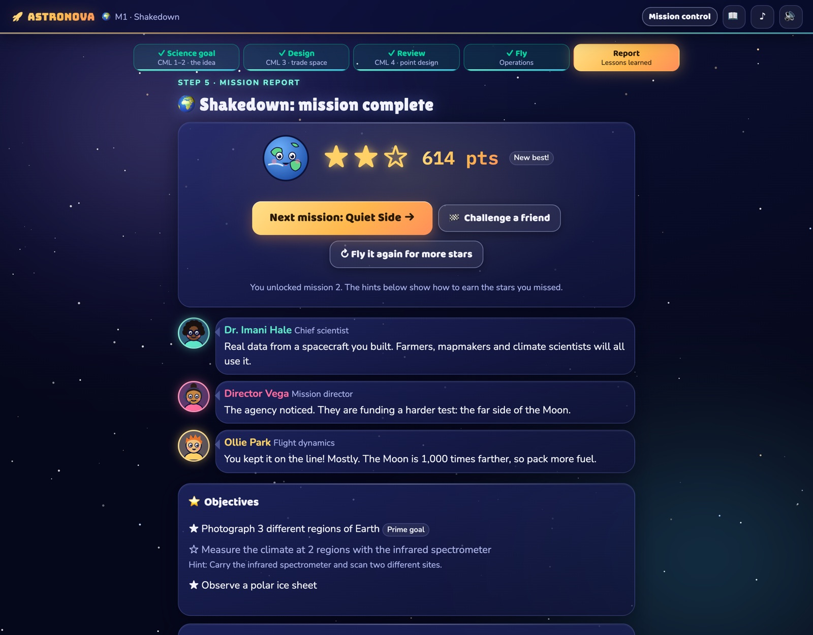<br><sub><b>Mission report.</b> Stars, score, crew reactions, hints for what you missed, and real missions like yours.</sub></td>
    <td>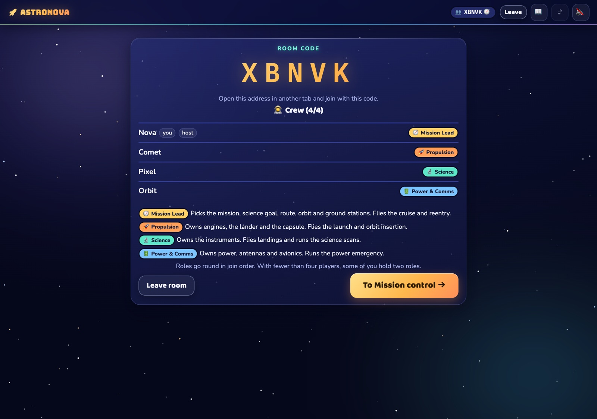<br><sub><b>Co-op lobby.</b> Share a room code. Everyone gets a crew role.</sub></td>
  </tr>
</table>

### 📱 On your phone

<p align="center">
  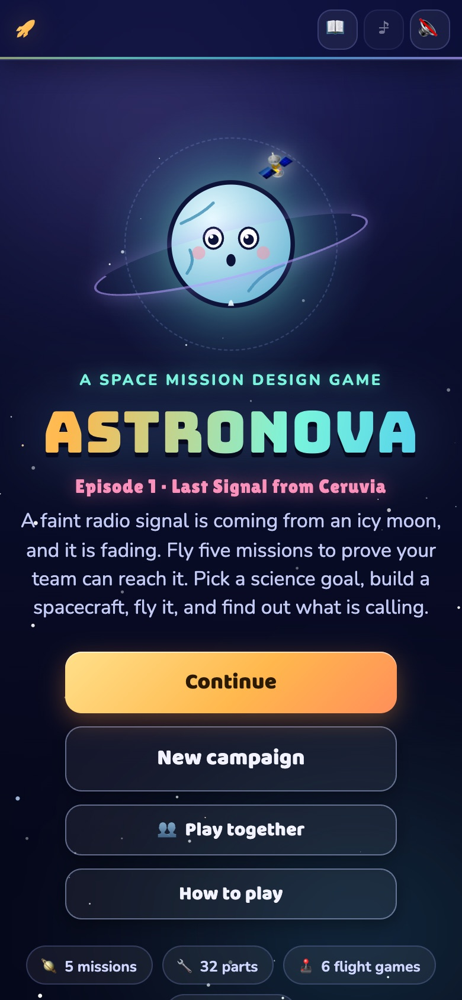
  &nbsp;
  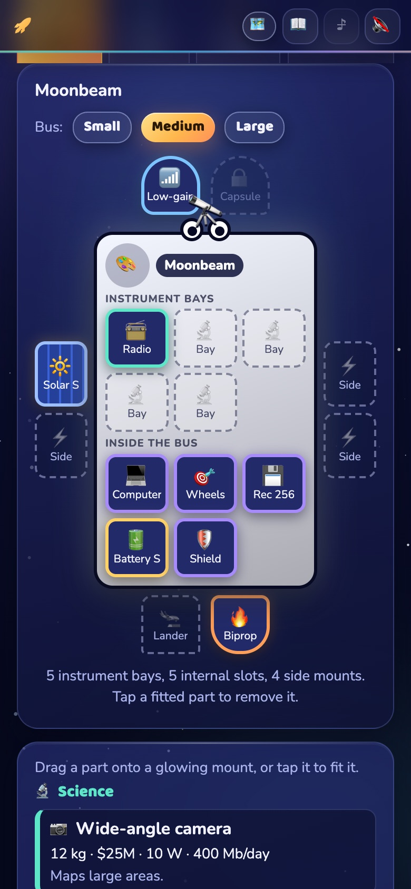
  &nbsp;
  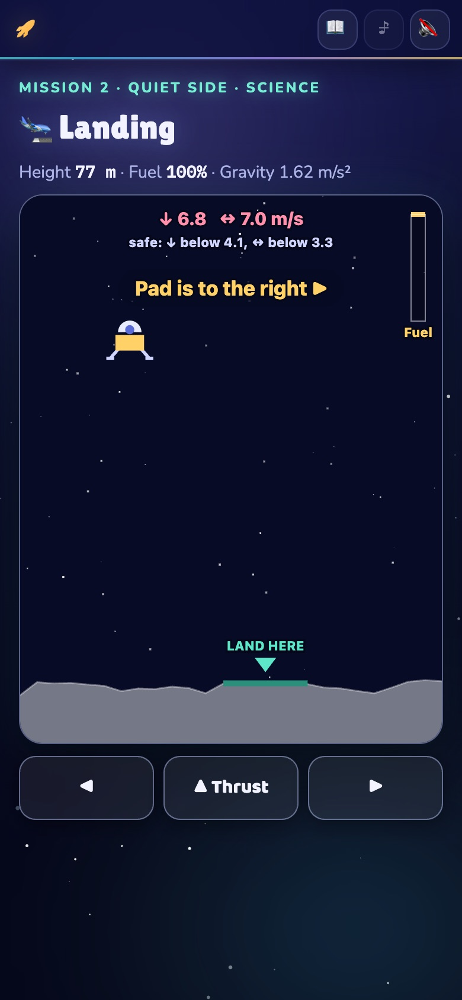
</p>
<p align="center"><sub>Every screen fits a 375 px phone. Touch buttons appear under each minigame.</sub></p>

<sub>All screenshots are captured from the real game. The game itself draws everything in code: it uses no image files.</sub>

---

## Contents

**For players**
- [Screenshots](#-screenshots)
- [Quick start](#quick-start)
- [How a mission works](#how-a-mission-works)
- [Controls](#controls)
- [The minigames](#the-minigames)
- [The five missions](#the-five-missions)
- [Difficulty levels](#difficulty-levels)
- [Stars, unlocks and scoring](#stars-unlocks-and-scoring)
- [Playing together (co-op)](#playing-together-co-op)
- [Extras: badges, hats, patches and challenges](#extras-badges-hats-patches-and-challenges)
- [Tips if you get stuck](#tips-if-you-get-stuck)

**How it works**
- [The engineering model](#the-engineering-model)
- [Parts, rockets and spacecraft sizes](#parts-rockets-and-spacecraft-sizes)
- [How the challenge resources shaped the game](#how-the-challenge-resources-shaped-the-game)
- [NASA data and resources used](#nasa-data-and-resources-used)

**For developers**
- [Running it locally](#running-it-locally)
- [Project layout](#project-layout)
- [Architecture](#architecture)
- [Adding content](#adding-content)
- [Testing](#testing)
- [Deploying](#deploying)
- [Online co-op setup (Firebase)](#online-co-op-setup-firebase)
- [Troubleshooting](#troubleshooting)

**About**
- [Use of AI](#use-of-ai)
- [Accessibility](#accessibility)
- [Privacy](#privacy)
- [References and licenses](#references-and-licenses)
- [Disclaimer](#disclaimer)
- [License](#license)

---

# For players

## Quick start

1. Open the game and press **Play**.
2. Type a nickname. Please don't use your real name.
3. Choose **Beginner**. It gives you lots of money, no surprise setbacks, autopilots that fly with you, on-screen hints, and Ollie the coach to show you every step. It's hard to fail.
4. On **Mission control**, press the glowing mission marked **▶ Start here**.

From then on, every screen tells you what to do next.

## How a mission works

Every mission follows the same five phases. The bar at the top of the planning screens shows where you are, labelled with JPL's Concept Maturity Levels (CML), the scale real teams use to say how far a mission idea has grown.

| Phase | What you do | CML label |
|---|---|---|
| **1. Science goal** | Read the briefing, then pick one *prime goal*. Each goal says who uses the data and which parts (★) it needs. | CML 1–2 · the idea |
| **2. Design** | Build the spacecraft in the hangar and plan the trip. | CML 3 · trade space |
| **3. Review** | Pass the launch review. Red items stop the launch, amber items are risks you can accept. | CML 4 · point design |
| **4. Fly** | Fly each part of the trip in short arcade minigames, then choose where to point your instruments. | Operations |
| **5. Report** | See your stars and score, what you discovered, and what to try next. | Lessons learned |

### The hangar

The hangar has four tabs.

- **🔧 Build:**
  - **Fitting parts:** drag parts from the shelf onto the spacecraft, or tap a part to fit it automatically. On a touch screen, press and hold to drag. Tap a fitted part to remove it.
  - **Mounts:** each mount takes one kind of part. The engine goes at the bottom, the antenna on top, wings on the sides, and instruments and electronics in the body.
  - **Spacecraft size:** pick a small, medium or large bus. A bigger bus has more mounts but is heavier and costs more.
- **🗺️ Plan:** choose the rocket, the orbit and the ground stations. Under "More settings" you can also choose the route, the fuel and how many months of science to fly.
- **🎨 Paint:** pick a colour, name the spacecraft, draw your own mission patch and choose a hat.
- **⚖️ Compare:** save up to three designs and see them side by side. Real teams call this a *trade study*.

Above the tabs are six **meters**:

| Meter | What it means |
|---|---|
| ⚖️ Mass | How heavy the spacecraft is, compared with what the rocket can lift |
| ⛽ Fuel | Fuel carried, compared with what the trip needs |
| ⚡ Power | Electricity made, compared with electricity used |
| 💰 Budget | What everything costs, compared with your budget |
| 📶 Data | How much of your science data reaches Earth |
| ⏱️ Time | How long the trip takes, and the deadline if there is one |

Green is good, amber is risky and red stops the launch. Press any **?** for a plain-language explanation and a fix.

**Help in the hangar:**
- **Ollie the coach:** on Beginner, Ollie always shows the next thing to fix and offers a ✨ button that does it for you.
- **✨ Build it for me:** makes a simple design that passes the review and meets your goal. You can then change it.
- **🧭 Show me around:** a quick tour of the hangar.

### The launch review

The review checks your design the way a real review board would. It groups every item into four segments, following NASA's "Design and Develop Science Missions":

- 🚀 **Launch segment:** the rocket and the route
- 🛰️ **Space segment:** the spacecraft: power, fuel, computers and instruments
- 📡 **Ground segment:** the dishes on Earth that collect your data
- 🔬 **User segment:** the scientists who will use the data, and whether your design can meet the prime goal

Below that is **Your mission plan**, a concept-of-operations timeline from building and testing through launch, cruise, science and the trip home, with NASA's project phase letters. Next to it is a **trajectory diagram** of your route and orbit.

### Science operations

When you arrive, you get a number of **science passes**:

- **Choosing a site:** tap a site on the map. Glowing spots still have something new to find.
- **Scanning:** press **🔭 Science pass here**. A short timing game (press SCAN in the green zone three times) decides how good the data is. You can also choose **Auto scan**.
- **Landing and sampling:** if you brought a lander or a sample arm, you can also **🛬 Land here** or do a **🦾 Touch-and-go here**.
- **Objectives:** the list ticks off live as you complete objectives.
- **Finishing:** press **Finish science** when you're done.

On missions 4 and 5 a **power emergency** strikes, either a dust storm or a radiation storm. It's a turn-based puzzle: switch systems off to keep the battery above zero, and switch the transmitter on when you can afford it to send data home.

## Controls

| Action | Keyboard | Touch |
|---|---|---|
| Steer, move, thrust | Arrow keys or **W A S D** | On-screen buttons under the game |
| Burn, deploy, scan | **Space** | The wide button |
| Close a pop-up, the handbook or the tour | **Esc** | ✕ or the button in the pop-up |
| Open the handbook | | 📖 in the top bar |
| Sound on or off, music on or off | | 🔊 and ♪ in the top bar |

## The minigames

Every minigame opens with **"Your job"** in one sentence and two or three short steps. On Beginner, Cadet and Sandbox, big on-screen hints such as "Tip right ▶" or "Too fast! Hold ▲" tell you what to do while you fly.

| Minigame | Your job | Played on |
|---|---|---|
| 🚀 **Launch** | Keep the rocket lined up with the green dashed outline as it tips over (a gravity turn). Ease off the engine in the red Max-Q zone. | Every mission |
| ☄️ **Cruise** | Dodge the grey rocks. Grab the gold ✦ stars for bonus points. Each hit breaks a part unless a debris shield soaks it up. | Missions 2–5 |
| 🎯 **Orbit insertion** | Hold BURN to slow down, and let go when the speed marker is in the green zone. | Missions 2–5 |
| 🛬 **Landing** | Land gently on the flashing green pad. Hold ▲ to slow your fall, tap ◀ ▶ to slide toward the pad. | Missions 2, 4, 5 (with a lander) |
| 🦾 **Touch-and-go** | Touch the ground gently away from the boulders, wait 3 seconds while the arm grabs a sample, then fly back up. | Mission 3 (with a sample arm) |
| 🔥 **Reentry** | Keep the capsule inside the green path, then open the parachute when the speed marker is in the green. | Missions 3 and 5 (with a capsule) |

Your design changes how the games play:
- **Precise pointing:** precision pointing hardware steers quicker.
- **Weight:** a heavy spacecraft responds slowly.
- **Solar wings:** big wings make a bigger target for debris.
- **Shield:** a debris shield soaks up hits.

A **poor result** costs fuel, damages parts or loses science, and the mission still goes on. Landings, touch-and-gos and reentries can be **retried** a set number of times, depending on the difficulty.

## The five missions

You need at least one star on a mission to unlock the next.

| # | Mission | Target | What it teaches | Objectives (one star each) |
|---|---|---|---|---|
| 1 | **Shakedown** | Earth orbit | Mass, power and budget. Tilted orbits versus sun-synchronous orbits. | Photograph 3 different regions of Earth · Measure the climate at 2 regions with the infrared spectrometer · Observe a polar ice sheet |
| 2 | **Quiet Side** | The Moon | Radio noise, the lunar far side and landing. | Record the Ceruvia signal from the far side · Find water ice at the south pole · Land the lander safely |
| 3 | **Pebble Run** | Asteroid 2031 QX | Sample return, ion versus chemical engines, and reentry. | Grab a sample with a touch-and-go · Land the capsule on Earth with the sample · Find evidence of ancient water |
| 4 | **Red Shadow** | Mars | Solar versus nuclear power, dust storms, aerobraking and buried ice. | Find buried water with radar · Survive the dust storm without losing data · Land the lander safely |
| 5 | **Last Signal** | Ceruvia (fictional) | Everything at once: sunlight 90 times weaker, a 7.5-year deadline, and the trip home. | Confirm 3 of the 5 habitability clues · Find the source of the signal · Land the capsule on Earth |

Each mission offers two routes and two or three orbits, and the right choice depends on your goal:
- **Mission 1:** a cheap tilted orbit, or a polar orbit that sees the ice sheets.
- **Mission 4:** a fast braking burn, or slow, fuel-free aerobraking.
- **Mission 5:** a direct transfer, or a Jupiter gravity assist that saves fuel but takes two years longer.

Random **events** can happen on the way: solar storms, part failures, a fuel leak, an antenna outage, a budget review, debris warnings and flyby opportunities. Some ask you to make a choice.

## Difficulty levels

| Level | Budget | Events per mission | Retries | Piloting | Extras |
|---|---|---|---|---|---|
| **Beginner** (recommended) | ×1.8 | 0 | 5 | Autopilots: hard to fail | Coach, auto fuel, "Build it for me", on-screen hints, two bonus science passes, every scan finds what it can, a practice shield (debris never breaks parts), no fuel penalties, and a backup battery in the power emergency. The launch autopilot holds the line, the engine cuts off in the green, the lander flies itself to the pad, touch-and-go has no boulders, and the reentry heat shield always holds. Expert parts are hidden. |
| **Cadet** | ×1.3 | 1 | 2 | Forgiving | On-screen hints |
| **Engineer** | ×1 | 2 | 1 | Realistic | |
| **Flight Director** | ×0.85 | 3 | 0 | Hard | Steep ground can tip a lander |
| **Sandbox** | Unlimited | 0 | 9 | Forgiving | Every mission and part unlocked, on-screen hints |

You can change difficulty at any time from Mission control.

## Stars, unlocks and scoring

- **Stars:** each mission has three objectives, and each one you complete earns a star.
- **Unlocks:** one star unlocks the next mission.
- **Budget bonus:** every star you've earned adds **$30M** to the budget of later missions.
- **Prime goal:** the goal you picked at the start is worth an extra **100 points** if you meet it. You can still earn the other stars.

**Score breakdown** (shown on the report):

| Part | Points |
|---|---|
| Science | The sum of your discoveries' points. They're scaled by how good your scans were, how much data reached Earth, and how much of the time your instruments had power. Samples only count if the capsule gets home. |
| Objectives | 100 per star |
| Piloting | The sum of your minigame scores (0–100 each) |
| Data home | Up to 50, for the share of data that reached Earth |
| Budget left | Up to 100, for unspent money |
| Prime goal | 100 if you met it |

The report also shows hints for any objectives you missed, a "What to try next" list, the full mission log, **real missions like yours** and a leaderboard for this device.

## Playing together (co-op)

Two to four players build one spacecraft together and fly it as a crew.

1. One player presses **👥 Play together → Start a new room** and shares the 5-character **room code**.
2. Everyone else presses **👥 Play together**, types the code and presses **Join**.
3. When everyone is in, the host presses **To Mission control →**.

Each player holds one or more **roles**. Roles go round in join order, so with fewer than four players some people hold two.

| Role | Owns in the hangar | Flies |
|---|---|---|
| 👑 **Mission Lead** | Picks the mission, science goal, route, orbit and ground stations | Cruise and reentry |
| 🔥 **Propulsion** | Engines, the lander and the capsule | Launch and orbit insertion |
| 🔬 **Science** | Instruments | Landings, touch-and-go and science scans |
| ⚡ **Power & Comms** | Power, antennas and avionics | The power emergency |

- **Building together:** everyone sees every change live. Parts you don't own show who can fit them.
- **The launch vote:** at the review, everyone must vote **GO** before launch, just like a real flight director's poll.
- **Taking turns:** each minigame is flown by the player whose role owns it, and everyone else watches live.
- **Leaving:** press **Leave** in the top bar at any time. Your solo save is untouched.

You can try co-op on one computer by opening the game with `?local` at the end of the address in two browser tabs. Each tab is a player, and it works with no internet connection.

## Extras: badges, hats, patches and challenges

- **Badges:** 18 badges for things like a perfect launch, a pinpoint landing or a debris-free cruise. See them on Mission control.
- **Hats:** 9 hats for your spacecraft, unlocked as you earn badges. Everyone starts with the team's 🔭 telescope hat. Pick one in the Paint tab.
- **Discovery cards:** every find flips over as a collectible card, rated common, rare or epic.
- **Mission patch:** draw your own in the Paint tab. It appears on the review and the report.
- **Moods:** the spacecraft has googly eyes and reacts to your design, looking happy, worried or panicked.
- **Challenge a friend:** on the report, **🏁 Challenge a friend** makes a link with your score. Your friend opens it and tries to beat you on the same mission.
- **Design codes:** **Share design code** in the hangar gives a code starting with `LS1-` that you can send to someone. They load it from Mission control → **Load a design code**.
- **Music:** chiptune music, calm while planning and faster while flying. Toggle it with ♪.

## Tips if you get stuck

- **Follow the yellow:** the next step is always the gold button, the glowing card or the 👉 line.
- **Over budget:** the rocket is usually the biggest cost, so try a smaller one. Then remove parts your goal doesn't need. The ★ marks show what it does need.
- **Not enough fuel:** lighten the spacecraft, take the slower route, or add fuel in Plan → More settings.
- **Not enough power:** far from the Sun, solar wings get weak. Add a bigger wing, an RTG or a bigger battery.
- **Data not getting home:** fit a bigger dish or book more ground-station time.
- **Crashing landings:** come down slowly, stop sliding sideways before you touch, and use your retries.
- **Something else:** let Ollie or "Build it for me" make a working design, then change one thing at a time.
- **Handbook:** the 📖 handbook in the top bar explains every idea in the game.

---

# How it works

## The engineering model

The numbers are simplified, but the relationships are real. All the formulas live in `js/sim.js`, in `calc()`.

**Mass**
- **Dry mass** = parts + structure (the bus plus 10% of the parts' mass) + tanks (8% of the fuel's mass).
- **Wet mass** = dry mass + fuel.
- **Rocket capacity** = the rocket's lift to low Earth orbit × the mission's distance factor × the route's lift factor × the orbit's factor. Your wet mass must fit inside it.

**Fuel: the Tsiolkovsky rocket equation**
- Exhaust speed = engine Isp × 9.80665 m/s².
- Fuel needed = dry mass × (e^(Δv / exhaust speed) − 1), worked out for the braking burn at the target and, on return missions, the departure burn home. The lander is left behind before the trip home.
- On Beginner the tank fills itself: the fuel needed, plus 8%, rounded up to 10 kg.

**Power**
- Solar power = wing rating (kW) ÷ distance from the Sun² (in AU). Sunlight at Mars is under half of Earth's. At Ceruvia, 9.5 AU from the Sun, it is about 1/90th.
- An RTG gives 150 W and loses 1.6% a year during the cruise.
- Average power = RTG + solar × (1 − the share of each orbit spent in shadow).
- The battery must carry the spacecraft through the shadow. If power runs short, instruments run only part of the time, and that scales down your science.
- Heaters use 60 W beyond 3 AU and 30 W closer in.

**Data**
- Data sent home per day depends on the antenna's speed, the distance (signal strength falls with distance), and the hours of ground-station time.
- Anything that can't be sent waits in the recorder. If the recorder is too small, data is lost.

**Cost and time**
- **Cost** = parts + bus + rocket + operations (monthly costs during the cruise, doubled for a return trip, plus the months of science) + ground stations.
- **Budget** = the mission's base budget × the difficulty multiplier + $30M per star you've earned.
- **Build-and-test time** = 1.5 years + 0.06 years per part, plus extra for a lander, a capsule, an RTG or an ion engine. It appears first on the mission plan timeline.

**Launch review:** `reviewItems()` checks all of the above and marks each item *block*, *warn* or *ok*. `review()` sorts the items into the four segments.

The full write-up of every formula is in [`ENGINEERING_MODEL.md`](ENGINEERING_MODEL.md).

## Parts, rockets and spacecraft sizes

**32 parts** in six groups:

| Group | Parts |
|---|---|
| 🔥 Propulsion (3) | Bipropellant engine, High-performance engine, Ion engine |
| 🪂 Landing & return (3) | Return capsule, Surface lander, Sample collector arm |
| ⚡ Power (7) | Solar wings (6, 15 and 30 m²), RTG (nuclear power), Batteries (600 and 2,000 Wh), Emergency fuel cell |
| 📡 Comms (4) | Low-gain antenna, Medium dish (1.5 m), High-gain dish (3 m), Ka-band dish (4 m) |
| 🧠 Avionics (8) | Standard and rad-hard computers, Reaction wheels, Precision pointing, Recorders (32 Gb, 256 Gb, 2 Tb), Debris shield |
| 🔬 Science (7) | Wide-angle camera, High-res camera, Infrared spectrometer, Magnetometer, Radio receiver, Ground-penetrating radar, Mass spectrometer |

New parts unlock as the campaign goes on. On Beginner, nine *expert* parts stay hidden until you ask for them: the ion engine, the high-performance engine, precision pointing, the rad-hard computer, the fuel cell, the 2 Tb recorder, the Ka-band dish, the mass spectrometer and the giant solar wing.

**Rockets** (lift to low Earth orbit, cost):

| Rocket | Lift | Cost |
|---|---|---|
| Sparrow-1 | 5 t | $90M |
| Condor | 11 t | $170M |
| Albatross H | 21 t | $320M |
| Leviathan SH | 40 t | $600M |

**Spacecraft sizes (buses):** Small (120 kg, $80M), Medium (200 kg, $130M), Large (320 kg, $200M; unlocks on mission 2).

**Ground stations:** one station (4 h a day, $5M), a three-station network (8 h, $20M) or the network with priority time (16 h, $45M).

All rocket and part names are made up. The exact numbers for every part and mission are in [`DATA_REFERENCE.md`](DATA_REFERENCE.md) and in `js/data.js`.

## How the challenge resources shaped the game

| Resource | What it became in the game |
|---|---|
| NASA, *Design and Develop Science Missions* | You pick the science goal first. The launch review is grouped into launch, space, ground and user segments, and ground stations are a real choice. |
| JPL *Concept Maturity Levels* | The phase bar across the planning screens: Science goal (CML 1–2) → Design (CML 3, trade space) → Review (CML 4, point design) → Fly → Report. |
| NASA Goddard *Mission Design Lab* | The Compare tab: a trade study of up to three designs, side by side. |
| NASA *GMAT* and *Mission Viz* | The concept-of-operations timeline and the trajectory diagram in the launch review, and the rocket equation behind the fuel meter. |
| NASA Webb *Build It Yourself* | Every goal says who uses the data and marks the parts it needs. The report lists real missions like yours. |
| NASA *CubeSat 101* | The small spacecraft bus, and the power and data budgets of mission 1. |
| Canadian Space Agency digital games | Beginner mode, the coach and the plain-language tone. |

## NASA data and resources used

- [NASA: Design and Develop Science Missions (webinar slides, NTRS)](https://ntrs.nasa.gov/citations/20250002492)
- [JPL: Concept Maturity Levels, "Mission Development 101"](https://science.nasa.gov/wp-content/uploads/2023/11/03-ziemer-mission-development-101-cmls.pdf)
- [NASA Goddard: Mission Design Lab](https://etd.gsfc.nasa.gov/capabilities/integrated-design-center/mission-design-lab/)
- [NASA: General Mission Analysis Tool (GMAT)](https://software.nasa.gov/software/GSC-19640-1)
- [NASA: Web-based Mission Visualization (Mission Viz)](https://nasa.github.io/mission-viz/X3Dom/WebMissionVisualizationTutorialSeries.html)
- [NASA Webb: For Fun, including the "Build It Yourself" satellite game](https://science.nasa.gov/mission/webb/for-fun/)
- [NASA: CubeSat 101](https://www.nasa.gov/wp-content/uploads/2017/03/nasa_csli_cubesat_101_508.pdf)
- [Canadian Space Agency: digital games and activities](https://www.asc-csa.gc.ca/eng/youth-educators/digital-games-and-activities.asp)
- **Real missions.** Short facts, written in our own words from public mission pages, appear in "Real missions like yours":
  - NASA: Landsat 9, Terra, Lunar Reconnaissance Orbiter, LCROSS, OSIRIS-REx, Dawn, Mars Reconnaissance Orbiter, Perseverance, Opportunity, Cassini, Europa Clipper and Juno
  - JAXA: Hayabusa2
  - CNSA: Chang'e 4
- **Physics**, all simplified for play:
  - standard gravity (9.80665 m/s²) and the Tsiolkovsky rocket equation
  - the inverse-square fall-off of sunlight
  - the slow decay of radioisotope power
  - the shadow fraction of low orbits

The same links are in the game, in the handbook (📖) under **Learn more**.

---

# For developers

## Running it locally

AstroNova is plain HTML, CSS and JavaScript, with no build step, no framework, no npm and no bundler. Any static web server works:

```bash
python3 -m http.server 8767
```

Then open <http://localhost:8767/>.

Useful address options:

| Address | What it does |
|---|---|
| `http://localhost:8767/` | The normal game. Online co-op uses Firebase. |
| `http://localhost:8767/?local` | Co-op between tabs of one browser, with no Firebase or internet needed |
| `…/?vs=…` | Opens a "Challenge a friend" link. The game reads it and then cleans the address. |

Opening `index.html` straight from the file system mostly works, but use a server so that co-op and fonts behave.

## Project layout

```
astronova/
├── index.html              The page, fonts and the script order
├── style.css               Every style (base, hangar, minigames, co-op, the neon look)
├── js/
│   ├── data.js             All content: difficulties, crew, roles, parts, rockets, missions, events, handbook, links
│   ├── sim.js              The engineering model: calc(), the rocket equation, power, data, cost, the launch review
│   ├── audio.js            SFX: synthesized sound effects and procedural chiptune (Web Audio API)
│   ├── fx.js               Starfield, confetti, crew portraits and planets with faces (SVG), Ollie's quips
│   ├── builder.js          The hangar, drag and drop, Auto-build, Ollie the coach, the tour, patch drawing,
│   │                       the trade study, the phase bar, the mission plan timeline, the trajectory diagram
│   ├── minigames.js        The six flight minigames, the science scan, input and the game loop
│   ├── game.js             Global state S, screens, actions, the mission run, events, scoring, the report
│   ├── firebase-config.js  The public Firebase web config
│   ├── net.js              Online co-op: Firebase and local transports, rooms, roles, the vote, live watching
│   └── fun.js              Badges, hats, discovery cards, music switching, spacecraft moods, versus links
├── docs/screenshots/       Screenshots of the game used in this README
├── LICENSE                 Apache-2.0
├── README.md               This file
└── *.md                    The original design brief and build notes (see below)
```

The game uses **no image or audio files**. Every visual is CSS, SVG, canvas or a system emoji, and every sound is synthesized in code. The only images in the repository are the screenshots in `docs/screenshots/`, which are captures of the game for this README.

The other Markdown files are the design kit the game was built from:

| File | What it covers |
|---|---|
| [`PROMPT.md`](PROMPT.md) | The original brief and the 11 build steps |
| [`GUIDE.md`](GUIDE.md) | The rules that keep the game working, and how to add parts, missions, minigames, screens and buttons |
| [`ARCHITECTURE.md`](ARCHITECTURE.md) | File layout, script order, global state, the render loop, actions and the wrapper pattern |
| [`ENGINEERING_MODEL.md`](ENGINEERING_MODEL.md) | Every formula: mass, the rocket equation, power, data, cost, the review and scoring |
| [`GAME_DESIGN.md`](GAME_DESIGN.md) | The campaign, difficulty, hangar, minigames, beginner mode and fun layer |
| [`DATA_REFERENCE.md`](DATA_REFERENCE.md) | Tuned starting numbers for parts, rockets, buses, difficulties and missions |
| [`MULTIPLAYER.md`](MULTIPLAYER.md) | How co-op works |
| [`TESTING.md`](TESTING.md) | Test recipes, including the Auto-build check |
| [`COMPLIANCE.md`](COMPLIANCE.md) | The Space Apps compliance checklist |

These notes describe a reference design. The names in them are a guide, and the code in `js/` is the source of truth.

## Architecture

**Script order.** The scripts are classic `<script>` tags that share one global scope, so the order matters:

```
data → sim → audio → fx → builder → minigames → game → firebase-config → net → fun
```

**State.** One global object, `S` (in `game.js`), holds everything: the current screen, mission, design (`S.build`), plan (`S.plan`), the mission run (`S.run`), the minigame (`S.game`) and co-op players.

**Rendering.**
- Each screen is an entry in `SCREENS` with `html()`, and optionally `after()`, which runs once the HTML is in the page.
- `render()` draws the current screen into `#app`, and `go(name)` switches screen.
- `rerender()` redraws and keeps the scroll position.
- The hangar uses `refreshHangar()` to update only the parts that changed while you drag.

**Actions.**
- **Buttons:** a button looks like `<button data-act="name" data-arg="value">`. One delegated click listener calls `ACT[name](arg, element, event)`.
- **Text fields:** these use `data-input="name"` and call `INPUT[name]`.
- **Minigames:** they read keys from `K`, which is set by the keyboard and the touch buttons.

**The engineering model.** `calc(build, plan, mission, difficulty, bonus)` returns every derived number: mass, fuel, power, data, cost and time. Call it through `C()` for the current state. `review()` turns the result into review items.

**Minigames.** Each entry in `GAMES` has `init`, `step`, `draw`, `hud`, `finish` and `verdict`, plus `job`, `steps` and `how` for the intro card. `startGame(kind, options, onDone)` shows the intro, `gameBegin()` runs the countdown and the `requestAnimationFrame` loop, and `gameEnd(result)` scores the run and shows the verdict.

**The wrapper pattern.** Later files add behaviour by wrapping earlier functions instead of editing them. For example, `net.js` saves the original `render` and replaces it with a version that also shares state with the room:

```js
const _render = render;
render = function (...a) { const r = _render.apply(this, a); if (NET.on && !NET.applying) NET.share(); return r; };
```

`fun.js` adds badges, hats and moods the same way. Keep this pattern when you add a feature layer, and keep the script order.

**Saving.** Progress, badges, the leaderboard and settings are kept in `localStorage` under keys starting with `ceruvia-`, for example `ceruvia-save-v2`, `ceruvia-badges` and `ceruvia-board-v2`.

## Adding content

All content lives in `js/data.js`, so most changes need no code.

- **A part:** add an entry to `PARTS` with its category, mount slot, mass, cost, power and any special fields (such as `data` for instruments, `rate` for antennas or `isp` for engines). Set `unlock` to the mission number where it first appears. If beginners shouldn't see it, add its id to `ADVANCED` in `builder.js`.
- **A mission:** add an entry to `MISSIONS` with the target, the distance in AU, the budget, the minigames to play, routes (`trajs`), orbits, sites with discoveries for each instrument, three objectives with a `check()` function, briefing and ending dialogue, and the two "what matters most" notes. Add a hint for each objective to `OBJ_HINTS` in `game.js`. Add any "real missions like yours" to `REAL_MISSIONS`.
- **An event:** add an entry to `EVENTS` with `apply(run)`, or `choices`.
- **A difficulty:** add an entry to `DIFF` and `DIFF_ORDER`. `tol` sets how forgiving the minigames are: 1.4 or more turns on the hints, and Beginner (`simple: true`) turns on the assists.
- **A minigame:** add a `GAMES.kind` entry with the interface above, then call it from a step in `game.js`. Add it to `GAME_ROLE` in `data.js` so co-op knows who flies it.
- **A story, setting or names:** keep the structure and change the text in `data.js`.

Then run the Auto-build check in [Testing](#testing) to make sure every mission and difficulty is still winnable. [`GUIDE.md`](GUIDE.md) has step-by-step recipes for each kind of change.

If you add a new JS or CSS file, copy the AI-assistance header comment from an existing file.

## Testing

There is no test framework. Testing happens in the browser, and the recipes are in [`TESTING.md`](TESTING.md). The most important check runs every mission × goal × difficulty and confirms that Auto-build finds a design with no blocking review items that meets the goal. Paste it into the browser console on the game page:

```js
const fails = [];
for (const dk of DIFF_ORDER) for (const m of MISSIONS) {
  S.difficulty = dk; prepareMission(m);
  for (const o of m.objectives) {
    S.plan.goal = o.id; const r = recommendBuild(m);
    if (!r) { fails.push(`${dk} ${m.id} ${o.id}: no design`); continue; }
    S.build = r.build; S.plan = { ...r.plan, goal: o.id, ground: r.plan.ground || 'network' };
    const c = C(), blocks = review(S.build, S.plan, m, c).filter(i => i.level === 'block');
    if (blocks.length || !goalStatus(S.build, S.plan, m, o.id).ok) fails.push(`${dk} ${m.id} ${o.id}`);
  }
}
console.log(fails.length ? fails : 'All 75 combinations pass');
```

Before each release we also check:
- **Muted:** play with sound and music muted.
- **Console:** no errors.
- **Phone width:** at 375 px there is no sideways scrolling.
- **Co-op:** two `?local` tabs cover shared edits, role locks, the vote, hand-offs, live watching and the report.

Two things can fool you while testing:
- **Background tabs:** browsers pause `requestAnimationFrame` in background tabs, so minigames freeze there.
- **Old files:** after an edit, do a hard refresh so the browser doesn't keep using its stored copy.

## Deploying

The live game is served by **GitHub Pages** straight from the `main` branch at the repository root, with no build step. Pushing to `main` updates <https://saket-vanga.github.io/astronova/> within a minute or two.

To host it somewhere else, upload the files as they are to any static host.

## Online co-op setup (Firebase)

Online play uses a free Firebase project. This copy is already connected to the team's project (`js/firebase-config.js`). To use your own:

1. Go to the [Firebase console](https://console.firebase.google.com), choose **Create a project**, and turn Google Analytics **off**.
2. **Build → Authentication → Get started → Sign-in method → Anonymous → Enable.**
3. **Build → Realtime Database → Create database**, choose any location and **locked mode**. In the **Rules** tab, paste this and press **Publish**:

   ```json
   {
     "rules": {
       "rooms": {
         "$code": {
           ".read": "auth != null",
           ".write": "auth != null && $code.matches(/^[A-Z0-9]{5}$/)"
         }
       }
     }
   }
   ```

4. **Project settings (gear icon) → General → Your apps → Web `</>` → Register app**, then copy the `firebaseConfig` values into `js/firebase-config.js` as `window.FIREBASE_CONFIG = { ... };`. Check that the block includes `databaseURL`.

Firebase web config values are meant to be public, because they ship to every player. The database rules protect the data: only signed-in players can use it, and only inside 5-character rooms.

Each room lives at `rooms/<CODE>` with `players`, `state`, `live` and `patch`. A player's entry is removed when they leave or disconnect. Old rooms can be deleted by hand from the Realtime Database page.

If `FIREBASE_CONFIG` is `null`, the game still runs, and **Play together** explains how to try `?local` mode instead.

## Troubleshooting

| Problem | What to try |
|---|---|
| I still see an old version | Hard refresh: **Cmd+Shift+R** on a Mac, **Ctrl+Shift+R** on Windows. |
| No sound | Sound starts after your first tap or click, because browsers require that. Check 🔊 and ♪ in the top bar. |
| A minigame seems frozen | It pauses when its tab is hidden. Bring the tab to the front. |
| "Could not reach the online service" | Check your internet connection. Co-op loads Firebase only when you play online. |
| "No room with that code" | Check the letters. A room disappears once everyone has left. |
| I want to start over | Mission control → **Reset progress**. To clear everything, delete this site's data in your browser settings. |
| Fonts look plain | The fonts come from Google Fonts. Offline, the game falls back to system fonts and still works. |

---

# About

## Use of AI

The Space Apps rules call this "Super Intelligence". Here is how we used it.

**What the team decided:**
- the challenge and the story idea (a fading signal from an icy moon; design, launch and explore; survive a power shortage; bring something home)
- the design brief and the build plan
- the name "AstroNova", the team name "Hubble Huddle" and the team touches
- how easy it should be, and the look of the game
- setting up the Firebase project for online play

We approved each build step before it started, playtested and reviewed the result, and decided what to change.

**What the AI wrote:** Claude, an AI assistant made by Anthropic, used through Claude Code, assisted us in writing:
- the code (HTML, CSS and JavaScript)
- the procedural sound effects and chiptune music, synthesized in code with the Web Audio API


It also tuned the numbers, simulated the minigames to balance their difficulty, and tested each step in a browser.

**What the AI did not make:** there are no AI-generated images. The game has no image or audio files at all, and every visual is drawn in CSS, SVG or canvas, or is a system emoji. The screenshots in this README are captures of the running game.

**Where it's disclosed:**
- a header comment at the top of every JS and CSS file
- a comment and an `ai-assistance` meta tag in `index.html`
- "About this game" in the in-game handbook
- this section

## Accessibility

- Works with a **keyboard** (arrow keys, WASD, Space, Esc) or a **touch screen**.
- Fits phone screens down to **375 px** wide.
- Honours **reduced motion**: if your device asks for less motion, every animation is turned off.
- **Plain language** throughout, with jargon explained the first time it appears and a **?** on every meter.
- **Forgiving difficulty** options, with retries and automatic assists on Beginner.
- Sound and music can be switched off separately, and the game never relies on sound alone.
- Buttons have labels for screen readers, and messages are announced in live regions.

## Privacy

- **Nickname only:** the only thing you type is a nickname, used for the leaderboard and co-op. Please don't use your real name.
- **Saved on your device:** progress, badges and the leaderboard stay in your browser's local storage.
- **Online co-op:** uses anonymous Firebase sign-in, with no email or account. A room holds only nicknames and the shared game state.
- **Nothing else:** no analytics, no ads and no tracking.

## References and licenses

| What | Used for | License |
|---|---|---|
| [Baloo 2](https://fonts.google.com/specimen/Baloo+2), [Bungee](https://fonts.google.com/specimen/Bungee), [IBM Plex Mono](https://fonts.google.com/specimen/IBM+Plex+Mono), [Lilita One](https://fonts.google.com/specimen/Lilita+One), [Nunito](https://fonts.google.com/specimen/Nunito) | Fonts, loaded from Google Fonts | SIL Open Font License 1.1 |
| [Firebase JavaScript SDK](https://github.com/firebase/firebase-js-sdk) 10.12.2 (compat: app, auth, database) | Online co-op, loaded from gstatic.com only when you play online | Apache-2.0 (its bundled protobuf code is BSD-3-Clause) |
| Firebase Authentication (anonymous) and Realtime Database | Online co-op rooms | Google service, [Firebase terms](https://firebase.google.com/terms) |
| GitHub and GitHub Pages | Code hosting and the public build | GitHub service |
| NASA, JPL, Goddard and CSA resources listed above | Research and design reference, linked, not copied | Public pages, used for reference only |
| System emoji | Icons and faces | Rendered by your device's emoji font |

No NASA logos, insignia or mission patches are used. Rocket names, part names and Ceruvia are made up.

## Disclaimer

This game is not affiliated with or endorsed by NASA, JPL, the Canadian Space Agency or any other space agency. It is a fan-made educational game for the NASA Space Apps Challenge. Our team name, Hubble Huddle, is a nod to the Hubble Space Telescope, not a link to it.

## License

[Apache License 2.0](LICENSE). Copyright 2026 Team Hubble Huddle.
